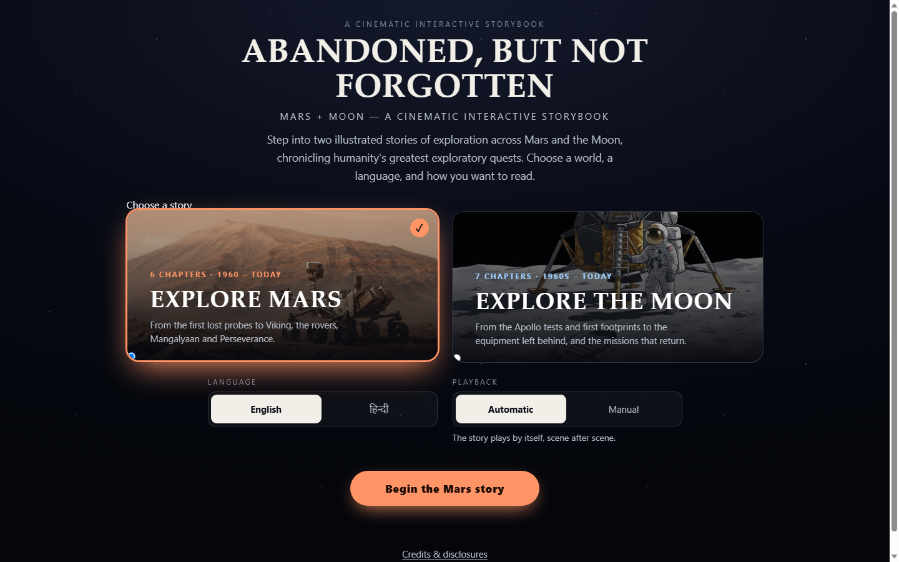
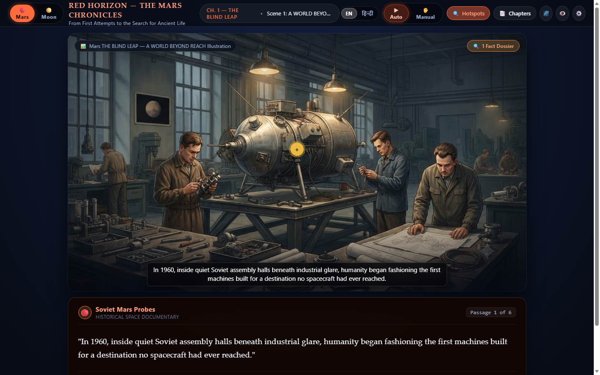
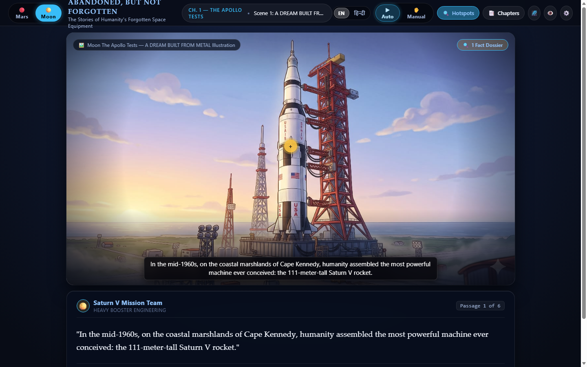
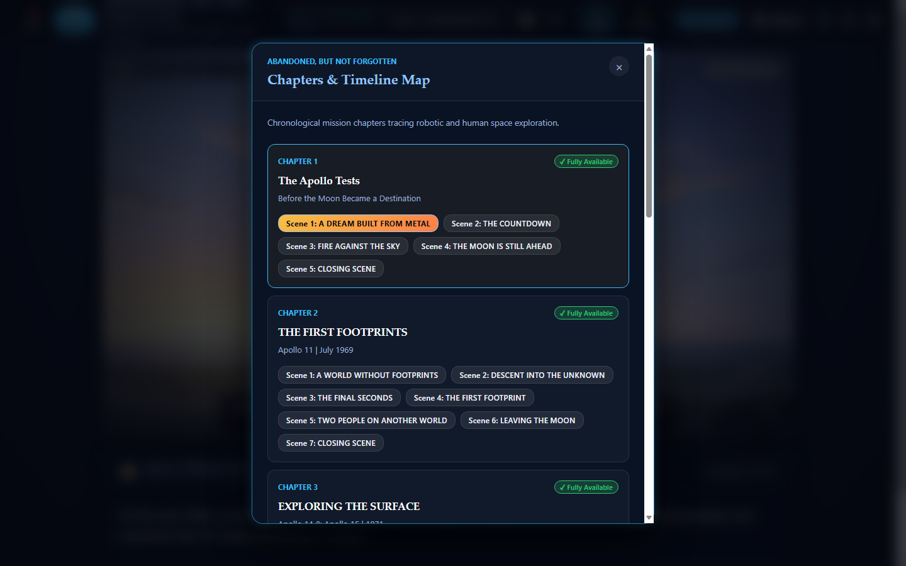
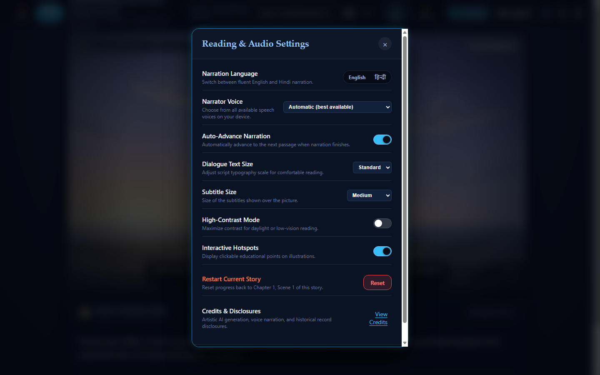
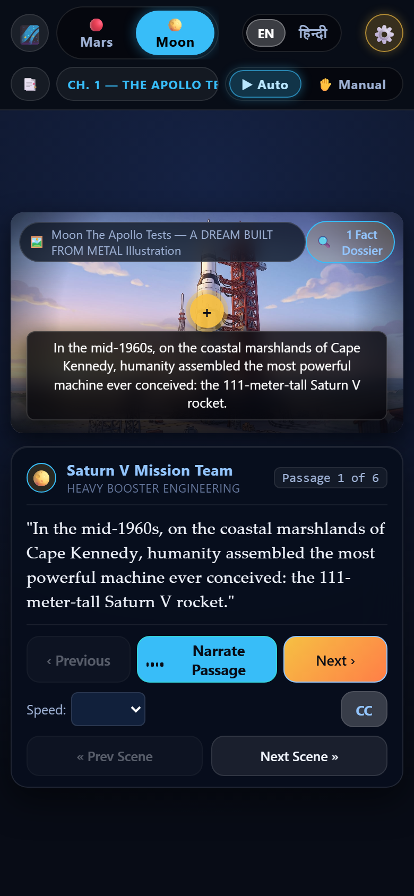

# 🌌 ABANDONED, BUT NOT FORGOTTEN
### Unified Interactive Historical Space Exploration Showcase (Mars & Moon)

[](#)
[](#)
[](#technologies-used)
[-brightgreen.svg)](#technologies-used)
[](#english-and-hindi-narration)
[](#licensing-and-intellectual-property)

---

## 🌟 Introduction

**Abandoned, But Not Forgotten** (alongside **Red Horizon: The Mars Chronicles**) is an interactive, historically grounded, dual-experience space exploration web project. It chronicles humanity’s greatest exploratory quests across the 20th and 21st centuries—capturing the bold technical achievements, hardware challenges, scientific discoveries, and quiet solitude of the robotic emissaries and lunar equipment left behind on distant worlds.

Built entirely with standard vanilla web technologies, the project executes 100% client-side in modern web browsers without external framework overhead, third-party runtime bundles, database latency, or paid API keys.

---

## 📸 Main Interface



*Figure 1: The Cinematic Story Gateway, offering one-click mission dispatch between the Martian Chronicles and Lunar expeditions, alongside real-time language and playback selection.*

---

## 📖 Project Overview

Human space exploration is marked not only by triumphs in human flight, but by hundreds of silent mechanical explorers—orbiters, landers, rovers, and experiment packages—that remain where their journeys ended. 

This interactive project merges deep historical research with cinematic storytelling:
- **Two Complete Story Expeditions:** Explore the red deserts of Mars or the dusty regolith of the Moon.
- **Historically Grounded Technical Dossiers:** Over 82 interactive hotspots revealing mechanical schematics, telemetry data, and authentic mission outcomes.
- **Adaptive Dual-Language Audio Narration:** Full spoken voice synthesis in both **English** and **Hindi**, calibrated dynamically using browser-native speech synthesis.
- **Responsive Dual-Form Factor UI:** Tailored desktop widescreen immersion paired with a dedicated mobile-optimized touch interface.

---

## 🔴 The Mars Experience: *Red Horizon — The Mars Chronicles*

> *"From First Attempts to the Search for Ancient Life"*

Spanning from 1960 to the present day, **Red Horizon** traces the grueling trial-and-error path humanity walked to conquer interplanetary communication, entry, descent, and surface rover science.

```
1960 ──────────────► 1976 ──────────────► 1997 ──────────────► 2008 ──────────────► 2013 ──────────────► 2021+
Soviet Probes       Viking 1 & 2        Pathfinder / MER     Phoenix / InSight   MOM (Mangalyaan)    Perseverance & Ingenuity
```

### Chronological Chapters:
1. **Chapter 1: The Blind Leap (1960–1965)** — Early Soviet Mars probes (Mars 1, Zond 2) and the brutal odds of early interplanetary trajectories.
2. **Chapter 2: Touchdown on the Red Planet (1976–1982)** — Viking 1 & Viking 2 landers, biological soil tests, and the first color panoramas of Martian plains.
3. **Chapter 3: Wheels on Dust (1997–2019)** — The rover revolution: Sojourner's pathfinding, Spirit's persistence, and Opportunity's marathon across Meridiani Planum.
4. **Chapter 4: The Climate Detectives (2008–2022)** — Phoenix digging into arctic permafrost and InSight listening to the interior pulse of marsquakes.
5. **Chapter 5: India's Orbital Triumph (2013–2022)** — Mangalyaan (Mars Orbiter Mission / MOM), executed on an unprecedented budget with flawless orbital capture.
6. **Chapter 6: The Modern Frontier (2012–2026)** — Curiosity and Perseverance drilling ancient river deltas, paired with Ingenuity's historic aerodynamic flights.
7. **Epilogue:** *The Footprints We Leave Behind* — A philosophical reflection on the machines resting forever in the red dust.

* **Metrics:** 37 Scenes · 218 Passages · 18 Video Animations · 37 Interactive Dossiers

---

## 🌕 The Moon Experience: *Abandoned, But Not Forgotten*

> *"The Stories of Humanity's Forgotten Space Equipment"*

Covering the 1960s Apollo era through modern Artemis international exploration, this story explores the hardware, seismometers, rovers, and descent stages that forever remain on the Moon.

```
1968 ──────────────► 1969 ──────────────► 1971 ──────────────► 1972 ──────────────► 2009 ──────────────► 2024+
Apollo Tests        Apollo 11 Landing   Apollo 14 & 15       Apollo 17 / ALSEP   LRO Mapping         Artemis & Commercial Moon
```

### Chronological Chapters:
1. **Chapter 1: The Apollo Tests** — Preparing Saturn V, the Lunar Module, and circumlunar qualification before landing was possible.
2. **Chapter 2: The First Footprints (Apollo 11)** — Eagle's descent to the Sea of Tranquility, Armstrong and Aldrin's surface timeline, and the silent descent stage left behind.
3. **Chapter 3: Exploring the Surface (Apollo 14 & Apollo 15)** — Fra Mauro highlands, the first Lunar Roving Vehicle traversing Hadley Rille, and core drillings.
4. **Chapter 4: Beyond the Landings (ALSEP 1969–1977)** — The Apollo Lunar Surface Experiments Package: nuclear-powered science stations transmitting data long after crews departed.
5. **Chapter 5: Orbiting Echoes (LRO 2009–present)** — The Lunar Reconnaissance Orbiter photographing rover tracks and descent stages from lunar orbit.
6. **Chapter 6: The Modern Frontier (Artemis & International Science)** — Commercial Lunar Payload Services (CLPS), Chandrayaan, SLIM, and the Artemis lunar infrastructure.
7. **Chapter 7: Legacy Left Behind** — The archeological preservation of historic lunar landing sites and our future on the Moon.
8. **Final Scene:** *A Small Blue World* — Gazing back at Earth from the silence of the lunar surface.

* **Metrics:** 45 Scenes · 268 Passages · 24 Video Animations · 45 Interactive Dossiers

---

## 🎮 Key Features & Interactive Storytelling

* **Cinematic Stage Viewport:** Dynamic Ken Burns panning effects, atmospheric vignette overlays, and smooth scene cross-fades.
* **Synchronized Bilingual Subtitles:** Real-time caption overlays matched with spoken narration, configurable in size (Compact, Standard, Large, Extra-Large).
* **Interactive Educational Hotspots:** Clickable targets overlaid on artwork that open detailed technical dossiers covering spacecraft architecture, historical context, and engineering solutions.
* **Dual Playback Modes:**
  * **Automatic Mode:** Advances continuously through passages, video sequences, and scenes for a hands-free documentary experience.
  * **Manual Mode:** Provides step-by-step navigation for readers desiring slow inspection of dialogue, imagery, and hotspots.
* **Intelligent Audio Arbitration:**
  * Authentic mission audio clips automatically pause synthetic speech and present an active audio badge (`🔊 Original Video Audio Playing`).
  * Seamless return to voice synthesis upon completion of video audio clips.
* **Zero Latency State Persistence:** User chapter progression, speech rate, preferred language, voice pack, and subtitle scale are saved locally in browser `localStorage`.
* **Keyboard Navigation Support:**
  * `←` / `→` : Previous / Next passage
  * `Space` : Play / pause narration
  * `A` : Toggle Automatic / Manual mode
  * `H` : Toggle interactive hotspots
  * `L` : Switch language (English / Hindi)
  * `I` : Immersive fullscreen stage view
  * `Esc` : Close active modals or exit immersive mode

---

## 🎙️ English and Hindi Narration

The project integrates browser-native **W3C Web Speech API (`window.speechSynthesis`)** with custom acoustic calibration:

* **English Delivery (EN):** Articulate, documentary-grade pacing optimized for scientific terminology and mission transcripts.
* **Hindi Delivery (हिन्दी):** Formal, grammatically authentic Hindi translations incorporating recognized space terminology (e.g., सैटर्न V, अपोलो 11, मंगलयान, लूनर रोवर, लैंडर).
* **Voice Pack Calibration:** Dynamically parses all installed client voice synthesis engines (Microsoft Natural Voices on Edge/Windows, Google TTS voices on Chrome, Apple voices on Safari) allowing readers to select their preferred narrator.

---

## 💻 Technologies Used

Built strictly adhering to progressive enhancement and standard vanilla web architectures:

| Layer | Implementation | Notes |
| :--- | :--- | :--- |
| **Markup & Semantics** | HTML5 Semantic Architecture | Accessible ARIA landmarks, modal dialogs, accessible forms |
| **Styling & Effects** | Vanilla CSS3 | Custom CSS variables, Flexbox, CSS Grid, Ken Burns keyframes, responsive typography |
| **Application Logic** | Vanilla JavaScript (ES6+) | Object-oriented state controller, event delegation, zero external frameworks |
| **Speech Engine** | W3C Web Speech API | Client-side synthesis, dynamic voice matching, pitch/rate controls |
| **Edge Hosting** | Cloudflare Pages | Global edge caching, automated Git deployments, zero server compute overhead |
| **Security & Headers** | `_headers` Config | Content-Type sniffing protection, SameOrigin framing, strict referrer policies |
| **Dependencies** | **0 NPM packages · 0 CDN bundles** | 100% self-contained code base running with zero third-party scripts |

---

## 🖼️ Screenshots Gallery

### 1. Story Gateway & Mission Selection

*Readers select their mission, language, and playback mode from the introductory launch screen.*

### 2. Mars Exploration Interface

*Mars Stage layout displaying high-resolution illustration, interactive hotspots, speaker attribution, and passage dialogue HUD.*

### 3. Moon Exploration Interface

*Lunar mission view featuring Apollo 11 historical reflection, specialized lunar color scheme, and synchronized subtitles.*

### 4. Chronological Chapter Navigation

*Interactive timeline map enabling instant exploration across all chronological mission chapters.*

### 5. Reading & Audio Settings

*Comprehensive configuration dialog for voice selection, playback speed (0.5× to 2.0×), narration language, and typography scale.*

### 6. Dedicated Mobile Experience
<p align="center">
  
</p>
<p align="center">
  <em>Dedicated touch-optimized mobile interface engineered specifically for smaller portrait viewports.</em>
</p>

---

## 🎨 AI-Generated Media Disclosure & Transparency

### Origin of Visual & Video Assets
All visual illustrations and animated video clips featured in this project were generated by the project creator using **Google Gemini AI**. They were created specifically as narrative storytelling elements to illustrate the emotional and technical journey of humanity's lunar and Martian space missions.

### Authenticity & Attribution Clarification
* **Artistic Reconstructions:** These visual media are artistic representations and should **not** be interpreted as authentic archival photographs, original mission footage, or official camera releases from space agencies.
* **Agency Independence:** NASA, ISRO, ESA, and Roscosmos are mentioned strictly for educational and historical documentation. **These space agencies did not create, sponsor, approve, or endorse the AI-generated illustrations or videos featured in this project.**
* **Historical Grounding:** While the visual scenes are AI-rendered interpretations, the missions, spacecraft designs, landing sites, launch timelines, scientific instruments, and historical outcomes depicted in the story are grounded in verified historical space exploration records.

---

## 📚 Historical & Scientific Mission Sources

The educational narrative, mission timelines, technical dossiers, and equipment descriptions in this project were developed using publicly available historical mission archives and open scientific documentation:

1. **NASA Apollo Lunar Surface Journal (ALSJ):** Mission transcripts, EVA logs, and ALSEP deployment data ([history.nasa.gov/alsj](https://history.nasa.gov/alsj/)).
2. **NASA Mars Exploration Program:** Scientific mission archives for Viking 1 & 2, Pathfinder, Spirit & Opportunity, Phoenix, InSight, Curiosity, and Perseverance ([mars.nasa.gov](https://mars.nasa.gov/)).
3. **NASA Lunar Reconnaissance Orbiter (LRO):** Surface documentation of Apollo landing sites ([lunar.gsfc.nasa.gov](https://lunar.gsfc.nasa.gov/)).
4. **ISRO Mars Orbiter Mission (MOM / Mangalyaan):** Orbital telemetry and science instrumentation archives ([isro.gov.in](https://www.isro.gov.in/)).
5. **NASA Space Science Data Coordinated Archive (NSSDCA):** Spacecraft data for early Soviet Mars probes and Mariner missions ([nssdc.gsfc.nasa.gov](https://nssdc.gsfc.nasa.gov/)).

---

## 👏 Credits & Acknowledgements

* **Creator & Author:** Hardik Bhawsar ([@bhawsarhardik195-blip](https://github.com/bhawsarhardik195-blip))
* **Historical Mission Documentation:** Dedicated to the engineers, flight controllers, scientists, and astronauts of NASA, ISRO, Roscosmos, and ESA whose achievements made these stories possible.
* **Audio Synthesis:** Standard W3C Web Speech API specification.
* **Hosting Infrastructure:** Cloudflare Pages edge delivery network.

---

## ⚖️ Licensing & Intellectual Property

* **Application Source Code:** Distributed under the open-source **MIT License**.
* **Visual & Video Assets:** Created with Google Gemini under Google Terms of Service for educational storytelling. Commercial reuse of the AI imagery should adhere to Google's terms and applicable jurisdictions.
